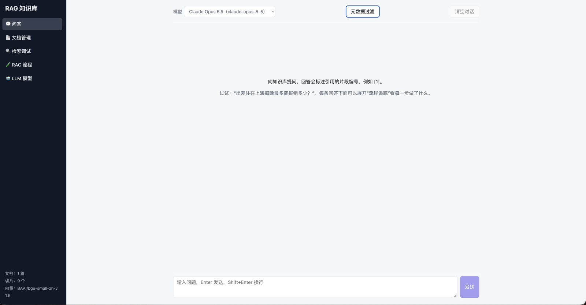
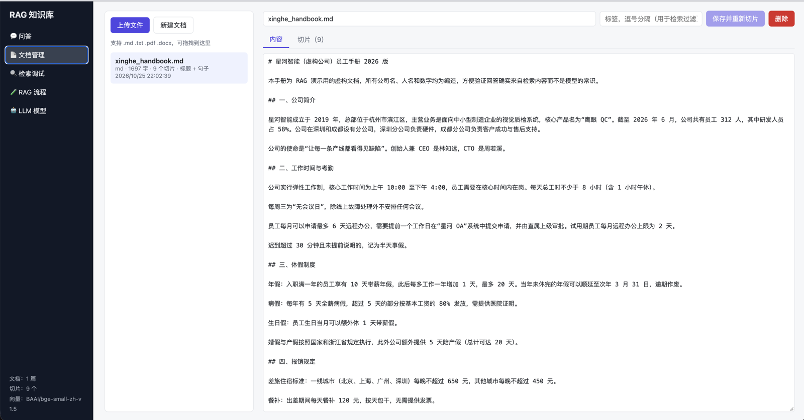
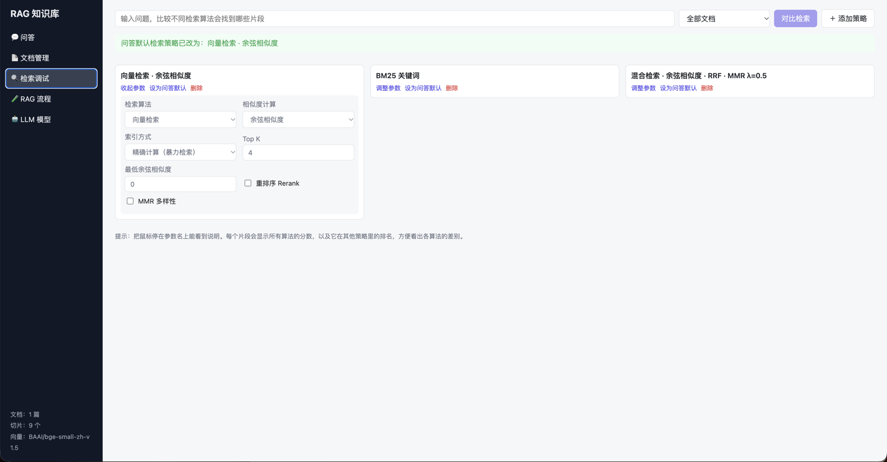
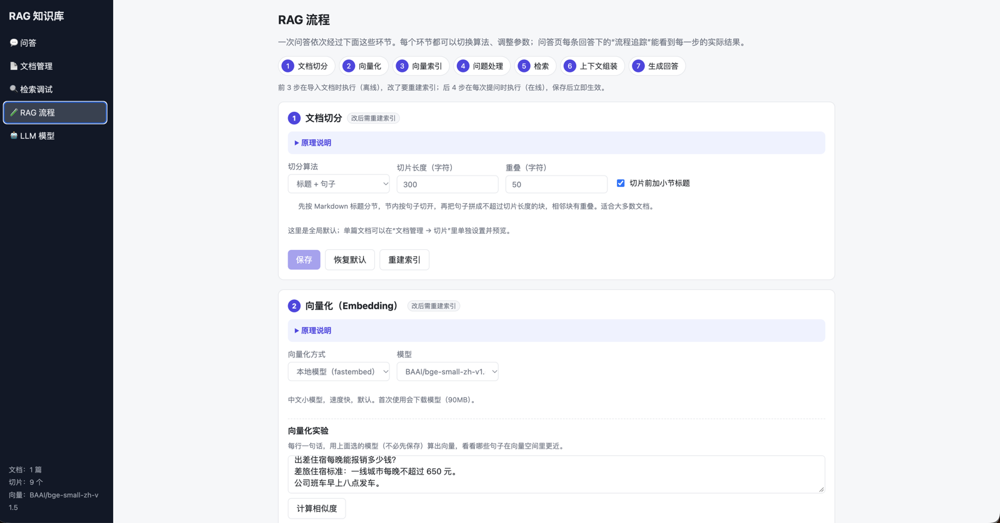
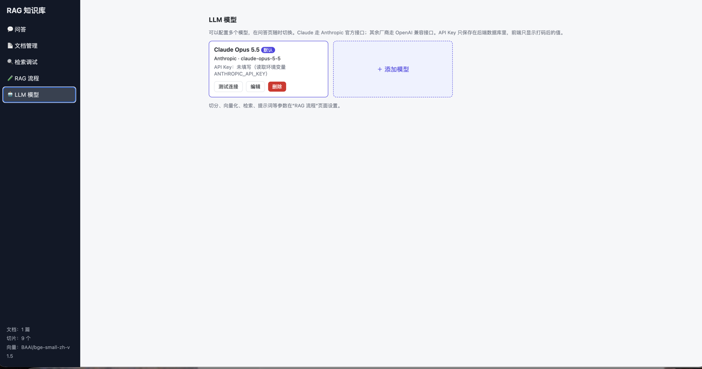

# RAG Knowledge Base Q&A (Full Stack)

[中文](README.md) | English

Upload documents → chunk → embed → store in a vector database → retrieve relevant chunks for each question → send the chunks and the question to an LLM → stream back an answer with citations.
Manage documents in the browser (upload / create / edit / delete), configure several LLMs and switch between them at any time.

The UI is available in Chinese and English: use the switch at the bottom of the sidebar. (The screenshots below show the Chinese UI.)



```
┌──────── Frontend React + Vite ────────┐         ┌─────────────── Backend FastAPI ───────────────┐
│ Chat · Documents · Search · Pipeline  │ ─/api─▶ │ Parse (md/txt/pdf/docx) → chunk → embed       │
└───────────────────────────────────────┘         │        │                          │           │
                                                  │  SQLite (text/config)     Chroma (vectors)    │
                                                  │                                   │           │
                                                  │ Question → retrieve top-k → prompt → LLM (SSE)│
                                                  │                Claude / OpenAI-compatible     │
                                                  └───────────────────────────────────────────────┘
```

## Features

| Feature | Details |
|---|---|
| Documents | Upload .md / .txt / .pdf / .docx (multiple files, drag and drop) or paste text to create one; edits are re-chunked and re-indexed automatically; vectors are deleted with the document |
| Chunking | Five strategies: headings + sentences, fixed length, by paragraph, recursive, semantic. Tune size, overlap and whether to prefix the section heading; set a global default or override per document, with a side-by-side preview before applying |
| Embedding | Switch in the browser: local [fastembed](https://github.com/qdrant/fastembed) models (default `BAAI/bge-small-zh-v1.5`, plus jina-zh, multilingual-e5, Qwen3-Embedding, bge-small-en…), OpenAI-compatible embedding APIs (OpenAI / Qwen / Zhipu / Ollama bge-m3…), or an offline character hash. An "Embedding lab" shows similarity between sentences |
| Vector store | [Chroma](https://www.trychroma.com/), persisted locally. HNSW parameters (distance, M, ef_construction, ef_search) are tunable; retrieval can use exact search or HNSW approximate search |
| Query processing | Condense with history, multi-query (fused with RRF), HyDE hypothetical document; each can be toggled |
| Metadata filter | Tag documents; Chat and Search lab can filter by document, tag and update date |
| Context assembly | Character budget, neighbor expansion (small-to-big), ordering (relevance / document order / most relevant at both ends) |
| Generation | Editable system prompt, user message template and per-source template; max_tokens, temperature (OpenAI-compatible), effort (Claude) |
| Pipeline trace | Under every answer: the condensed question, multi-queries, HyDE text, filter result, retrieval stats, context assembly, the full prompt sent to the model, and timings |
| LLMs | **Claude** (official Anthropic SDK), **OpenAI-compatible APIs** (OpenAI, DeepSeek, Qwen, Kimi, Zhipu…) and **local models** (Ollama / LM Studio / llama.cpp, e.g. Gemma 4, with auto-detection of installed models). Add several, set a default, test the connection, switch in Chat |
| Chat | SSE streaming; retrieved chunks (with similarity) arrive first, and the answer cites them as [1][2]; multi-turn, can be stopped at any time |
| Retrieval | Vector (cosine / dot product / Euclidean), BM25 keyword, hybrid (RRF or weighted), cross-encoder rerank, MMR diversity, Top K, cosine threshold, in any combination |
| Search lab | Compare up to 4 strategies side by side for the same question: each chunk shows cosine, dot, L2, BM25, hybrid, rerank and MMR scores plus its rank in the other strategies; make a strategy the Chat default in one click |
| Chinese / English UI | Switch at the bottom of the sidebar. All pages, explanations, backend error messages and default prompts follow; the choice is remembered in the browser |
| RAG pipeline page | All parameters in pipeline order "chunking → embedding → index → query → retrieval → context → generation", each step with a "How it works" explanation; changing the first three prompts you to rebuild the index |

## Screenshots

| Chat | Documents |
|---|---|
|  |  |
| **Search lab** (compare chunk similarity across retrieval algorithms) | **RAG pipeline** (chunking / embedding / index / query / retrieval / context / generation, each switchable) |
|  |  |
| **LLM models** (add and switch Claude, OpenAI-compatible and local models) | |
|  | |

## Quick start

### Option 1: Docker (recommended)

```bash
docker compose up --build
# open http://localhost:8000
```

The first start downloads a ~90MB embedding model (cached in `./data/models`). If HuggingFace is slow for you, use a mirror:

```bash
HF_ENDPOINT=https://hf-mirror.com docker compose up --build
```

### Option 2: Local development

Requires Python 3.10+ and Node.js 18+.

```bash
# backend
cd backend
python -m venv .venv && source .venv/bin/activate      # Windows: .venv\Scripts\activate
pip install -r requirements-dev.txt
uvicorn app.main:app --reload --port 8000

# frontend (in another terminal)
cd frontend
npm install
npm run dev                                           # open http://localhost:5173
```

In dev mode Vite proxies `/api` to port 8000. After `npm run build`, the backend serves `frontend/dist` itself, so only port 8000 is needed.

On first start the app automatically:
- imports the sample document `backend/sample_docs/xinghe_handbook.md` (a fictional employee handbook in Chinese; all numbers are made up so you can tell whether answers come from retrieval);
- adds a Claude Opus 5.5 model config. Enter an API key on the "LLM models" page, or set `ANTHROPIC_API_KEY` before starting.

### Using English documents

The preloaded sample is in Chinese, and the default embedding model `BAAI/bge-small-zh-v1.5` is Chinese-focused. For English:

1. Upload `backend/sample_docs/xinghe_handbook.en.md` (the English translation of the sample) on the "Documents" page, and delete the Chinese one if you like.
2. On "RAG pipeline → Embedding", pick an English or multilingual model, e.g. `BAAI/bge-small-en-v1.5` or `sentence-transformers/paraphrase-multilingual-MiniLM-L12-v2`, save, and click "Rebuild index".

Then try: "How much can I claim per night for a hotel in Shanghai?", "Until when can I use unused annual leave?", "What is the company's stock ticker?" (not in the document, so the model should say it couldn't find it).

## Adding other models

"LLM models" → "Add model" → choose a preset and enter the API key. Preset model names are only examples; change them to any model the vendor currently offers.

| Preset | API type | Base URL |
|---|---|---|
| Claude | Anthropic | empty (official) |
| OpenAI | OpenAI-compatible | `https://api.openai.com/v1` |
| DeepSeek | OpenAI-compatible | `https://api.deepseek.com` |
| Qwen (DashScope) | OpenAI-compatible | `https://dashscope.aliyuncs.com/compatible-mode/v1` |
| Kimi | OpenAI-compatible | `https://api.moonshot.cn/v1` |
| Zhipu GLM | OpenAI-compatible | `https://open.bigmodel.cn/api/paas/v4` |
| Local · Gemma 4 (Ollama) | OpenAI-compatible | `http://localhost:11434/v1`, model `gemma4:e4b` |
| Local · other Ollama model | OpenAI-compatible | `http://localhost:11434/v1` |
| Local · LM Studio | OpenAI-compatible | `http://localhost:1234/v1` |
| Local · llama.cpp server | OpenAI-compatible | `http://localhost:8080/v1` |

"Advanced params" is JSON: Claude supports `effort` (`low`/`medium`/`high`) and `max_tokens`; OpenAI-compatible APIs support `temperature`.

## Local models (Gemma 4 as an example)

Local models are free and keep data on your machine, which makes them a good comparison against Claude. Ollama, LM Studio and llama.cpp all expose OpenAI-compatible APIs, so no extra code or API key is needed.

**1. Install Ollama and download Gemma 4**

```bash
# install: https://ollama.com/download (installers for Mac / Windows; on Linux use this line)
curl -fsSL https://ollama.com/install.sh | sh

ollama pull gemma4:e4b     # fine for laptops and ordinary desktops
# ollama pull gemma4:e2b   # smallest, for tight memory
# ollama pull gemma4:26b   # MoE, 16GB+ VRAM recommended
# ollama pull gemma4:31b   # largest and strongest
ollama list                # show installed models
```

Once installed, Ollama runs in the background at `http://localhost:11434`.

**2. Add it in the browser**

"LLM models" → "＋ Add local model" → click "🔍 Detect local models". The backend scans the default ports of Ollama (11434), LM Studio (1234) and llama.cpp (8080) and lists installed models with parameter count, quantization and size; click one to fill in the Base URL and model name. Save, click "Test connection", then pick it from the model dropdown on the Chat page.

If your server uses a non-default port, edit the Base URL and click "Check this Base URL only".

**3. When running in Docker**

Inside the container, `localhost` is the container itself; reach Ollama on the host via `http://host.docker.internal:11434/v1`. `docker-compose.yml` already sets `extra_hosts: host.docker.internal:host-gateway` (needed on Linux, built in on Mac / Windows), and auto-detection tries this address first. On Linux, also make Ollama listen on all interfaces: `OLLAMA_HOST=0.0.0.0 ollama serve`.

**Tips**

- The first question is slow (seconds to tens of seconds) while Ollama loads the model into memory; later ones are fast.
- Small models are more likely to skip citations or make things up. Make the prompt more direct under "RAG pipeline → Generation" and lower the temperature (the preset uses 0.3).
- Ollama's default context window is small, so many chunks may get truncated. Lower the character budget under "Context assembly", or start Ollama with a larger context, e.g. `OLLAMA_CONTEXT_LENGTH=16384 ollama serve`.
- Embeddings can be local too: `ollama pull bge-m3`, then choose the OpenAI-compatible backend under "RAG pipeline → Embedding".

## Chunking strategies

Code: `backend/app/chunker.py`. Except for "fixed length", chunks never cross Markdown sections (Word heading styles are converted to Markdown headings on upload).

| Strategy | How it works | Good for |
|---|---|---|
| Headings + sentences (default) | Split each section into sentences and pack them into chunks up to the chunk size, with overlap | Most documents |
| Fixed length | Cut every N characters with a sliding-window overlap | Unstructured text, or as a baseline |
| By paragraph | Split on blank lines; merge short paragraphs, split long ones by sentence | Articles with clear paragraphs |
| Recursive | Split by paragraph → newline → period → comma → space → character, breaking at the largest boundary possible | Irregular text |
| Semantic | Embed neighboring sentences and break where their distance is above the Nth percentile | Long texts that jump between topics |

Under "Documents → Chunks" you can pick a strategy, click "Preview" to compare with the current chunks side by side, and "Apply to this document". Documents with their own setting aren't affected by the global default or "Rebuild index"; click "Use global default" to go back.

## Retrieval algorithms

Code: `backend/app/retrieval.py`. The flow: score → take candidates → (optional) rerank → (optional) MMR → threshold filter → Top K.

| Option | What it does |
|---|---|
| Vector + cosine / dot / Euclidean | Rank by semantic similarity. Models like bge output normalized vectors, so the three metrics rank almost identically, on different scales |
| BM25 | Keyword matching (Chinese is tokenized into single characters + bigrams, no dictionary; English by word). Good for names, IDs and numbers |
| Hybrid · RRF | Rank by vector and BM25 separately, then sum `1/(k+rank)`; score scales don't matter |
| Hybrid · weighted | Normalize both scores to 0–1, then `α·vector + (1-α)·BM25` |
| Rerank | Rescore the top fetch_k candidates with the cross-encoder `BAAI/bge-reranker-base` (the first use downloads a ~1GB model) |
| MMR | From the top fetch_k candidates, pick chunks that are relevant and not redundant with those already picked; lower λ favors diversity |
| Min cosine similarity | Whatever the algorithm, chunks with cosine similarity below the threshold are dropped |

With up to tens of thousands of chunks, exact numpy search over all chunks is fast enough; for more data, use Chroma's HNSW approximate search for candidates.

## RAG pipeline page (for learning)

The "🧪 RAG pipeline" page lists 7 steps in the order data flows through them, each with an expandable "How it works":

1. **Chunking**: five strategies (above)
2. **Embedding**: switch embedding models; the "Embedding lab" shows dimensions, time and pairwise similarity for a few sentences
3. **Vector index**: HNSW parameters; compare recall with "Exact / HNSW" in retrieval
4. **Query processing**: condense with history, multi-query, HyDE (each adds one LLM call)
5. **Retrieval**: every algorithm from the Search lab page
6. **Context assembly**: neighbor expansion, ordering, character budget
7. **Generation**: prompt templates and generation parameters

The first 3 steps run when documents are imported; after changing them, a banner asks you to rebuild the index (each embedding model + index parameter combination gets its own Chroma collection, so switching back needs no recomputation). The last 4 run on every question and take effect as soon as you save.

Suggested experiments:
- Switch embedding to "character hash", ask the same question, and compare the sources;
- Ask a follow-up ("What about Beijing?") with "Condense with history" on and off and compare retrieval;
- Remove "answer only from the sources" from the system prompt and ask something the documents don't cover to see whether the model makes things up;
- On the Search lab page, put "Exact" and "HNSW, 5 candidates" in two columns and compare recall.

## Environment variables

| Variable | Default | Description |
|---|---|---|
| `RAG_DATA_DIR` | `backend/data` | Directory for SQLite, Chroma and the model cache |
| `RAG_EMBEDDER` | `fastembed` | Initial embedding backend (switch later in the browser); `hash` is the offline character hash |
| `RAG_EMBED_MODEL` | `BAAI/bge-small-zh-v1.5` | Initial fastembed model |
| `ANTHROPIC_API_KEY` | | Used when the Claude config has no key |
| `RAG_CORS_ORIGINS` | `http://localhost:5173` | Allowed frontend origins when frontend and backend are deployed separately, comma separated |
| `RAG_MAX_UPLOAD_MB` | `20` | Maximum size of an uploaded file |

> After changing the embedding model or HNSW parameters, click "Rebuild index" in the banner at the top. The original text lives in SQLite, so you can rebuild at any time.

## Project structure

```
backend/
  app/
    main.py              FastAPI entry: creates tables, imports the sample, serves the frontend
    config.py            Paths and environment variables
    i18n.py              Chinese / English responses based on the Accept-Language header
    db.py                SQLite (document text, model configs, settings)
    parsers.py           md / txt / pdf / docx → plain text
    chunker.py           Five chunking strategies
    query.py             Query processing: condense, multi-query, HyDE
    context.py           Context assembly: neighbor expansion, ordering, budget
    embeddings.py        fastembed / OpenAI-compatible / hash embeddings
    store.py             Chroma vector store: write, delete, filter by document
    llm/                 Unified LLM interface: anthropic_provider.py, openai_provider.py
    services/            Business logic: documents / providers / local_models (local model detection) / settings / rag
    routers/             HTTP endpoints
  tests/                 pytest (hash embeddings and a fake LLM; no network or keys needed)
  sample_docs/           Sample documents (Chinese and English)
frontend/
  src/api.ts             API client + SSE parsing
  src/i18n.ts            Language switch: t("中文", "English")
  src/pages/             ChatPage / DocumentsPage / SearchPage / PipelinePage / SettingsPage
```

## API

| Method | Path | Description |
|---|---|---|
| GET/POST | `/api/documents` | List / create (JSON: name, content) |
| POST | `/api/documents/upload` | Upload files (multipart, field name `files`, multiple allowed) |
| GET/PUT/DELETE | `/api/documents/{id}` | Get / update (re-chunks automatically; pass `chunking` for a per-document strategy, or `use_default_chunking` to reset) / delete |
| GET | `/api/documents/{id}/chunks` | List chunks |
| POST | `/api/documents/preview-chunks` | Trial chunking without saving: `content` or `doc_id`, plus `chunking` |
| POST | `/api/documents/reindex` | Rebuild the whole index with the current settings |
| POST | `/api/search` | Retrieval only: `query`, `retrieval` (missing fields use the default strategy), filters `doc_ids` / `tags` / `date_from` / `date_to` |
| POST | `/api/search/compare` | Compare strategies: `query`, `doc_ids`, `strategies` (up to 6) |
| POST | `/api/chat` | Chat (SSE): `query`, `provider_id`, `history`, `retrieval`, filters; events are `trace`, `sources`, `delta`…, then `done` or `error` |
| GET/POST/PUT/DELETE | `/api/providers[/{id}]` | Model configs; `POST /{id}/default` sets the default, `POST /{id}/test` tests the connection |
| GET | `/api/providers/local/discover[?base_url=]` | Detect local Ollama / LM Studio / llama.cpp servers and their installed models |
| GET/PUT | `/api/settings` | Parameters of each pipeline step (chunking / embedding / index / query / retrieval / context / generation); `POST /api/settings/{section}/reset` restores defaults |
| GET | `/api/embedding/models` | Common embedding models |
| POST | `/api/embedding/test` | Embedding lab: `texts`; `backend` / `model` / `provider_id` can be overridden via query parameters |
| GET | `/api/documents/tags` | All tags |

Send `Accept-Language: en` to get English error messages and English default prompts; without it the API answers in Chinese.

Interactive API docs are at http://localhost:8000/docs once the server is running.

## Running tests

```bash
cd backend && pytest
```

## Ideas for later

- Other vector stores such as FAISS / Qdrant / Milvus
- Parent-child chunking, token-based chunk sizes
- Multi-user login with a separate knowledge base per user
- OCR for scanned PDFs
